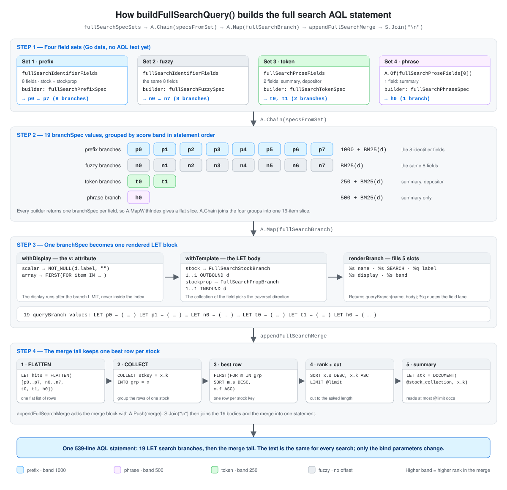

# How the Full Search AQL Statement Is Built

The `SearchStock` method runs one large AQL statement. No file in this
repository holds that statement as finished text. The Go code assembles
it from small parts each time `buildFullSearchQuery()` runs. This
document follows those parts in order and shows which piece of Go code
makes which piece of AQL.

## Table of Contents

- [What This Document Covers](#what-this-document-covers)
- [The Shape of the Final Statement](#the-shape-of-the-final-statement)
- [Visual Overview of the Build Pipeline](#visual-overview-of-the-build-pipeline)
- [Step 1: The Field Definitions](#step-1-the-field-definitions)
  - [The 8 Identifier Fields](#the-8-identifier-fields)
  - [The 2 Prose Fields](#the-2-prose-fields)
  - [The Four Spec Sets](#the-four-spec-sets)
- [Step 2: From Four Groups to 19 Branch Specs](#step-2-from-four-groups-to-19-branch-specs)
  - [How specsFromSet Expands One Group](#how-specsfromset-expands-one-group)
  - [The Four SEARCH Expressions](#the-four-search-expressions)
  - [The Four Score Bands](#the-four-score-bands)
  - [The Full List of 19 Branches](#the-full-list-of-19-branches)
  - [The Tests That Hold the Order and the Bands](#the-tests-that-hold-the-order-and-the-bands)
- [Step 3: From One Branch Spec to One AQL LET Block](#step-3-from-one-branch-spec-to-one-aql-let-block)
  - [withDisplay Picks the Display Expression](#withdisplay-picks-the-display-expression)
  - [withTemplate Picks the Branch Template](#withtemplate-picks-the-branch-template)
  - [renderBranch Fills the Five Slots](#renderbranch-fills-the-five-slots)
  - [What Each Clause in the Branch Template Does](#what-each-clause-in-the-branch-template-does)
- [Step 4: The Merge Block and the Complete Statement](#step-4-the-merge-block-and-the-complete-statement)
  - [fullSearchMergeBlock Builds the Tail](#fullsearchmergeblock-builds-the-tail)
  - [What Each Clause in the Merge Block Does](#what-each-clause-in-the-merge-block-does)
  - [buildFullSearchQuery Joins the Parts](#buildfullsearchquery-joins-the-parts)
  - [buildFullSearchQueryParams Attaches the Bind Parameters](#buildfullsearchqueryparams-attaches-the-bind-parameters)
- [The Assembled AQL](#the-assembled-aql)
  - [Branch p0, Prefix on stock_id](#branch-p0-prefix-on-stock_id)
  - [Branch n0, Fuzzy on stock_id](#branch-n0-fuzzy-on-stock_id)
  - [Branch p3, Prefix on label in the Property Collection](#branch-p3-prefix-on-label-in-the-property-collection)
  - [Branch t0, Token on summary](#branch-t0-token-on-summary)
  - [Branch h0, Phrase on summary](#branch-h0-phrase-on-summary)
  - [The Rendered Merge Block](#the-rendered-merge-block)
- [Source Files](#source-files)

## What This Document Covers

This document covers one subject only: the construction of the full
search AQL text. It explains the Go functions in plain words, so a
reader who does not know the `fp-go` library can follow the code.

Topics outside this subject are not here. The document does not cover
these parts of the feature:

- The two custom analyzers and the built-in text analyzer
- The creation of the ArangoSearch view and its reconciliation
- The input validation and the stopword rule
- The gRPC handler
- The read of the result rows from the database cursor

The glossary below gives the plain meaning of each `fp-go` helper that
the code extracts use. Each helper is a small, ordinary operation with a
functional name.

| Helper | What it does |
|--------|--------------|
| `F.Pipe1` to `F.Pipe4` | Send one value through 1 to 4 functions in order. The result of one function becomes the input of the next. |
| `A.Map(f)` | Apply `f` to every item of a slice. The output slice has the same length. |
| `A.MapWithIndex(f)` | The same as `A.Map`, but `f` also receives the position number of the item. |
| `A.Chain(f)` | Apply `f` to every item, where `f` gives back a slice, and then join those slices into one flat slice. |
| `A.Of(x)` | Make a slice that holds the single item `x`. |
| `A.From(a, b)` | Make a slice from the listed items. |
| `A.Push(x)` | Add `x` to the end of a slice. The result is a new slice, and the input slice does not change. |
| `P.Fold(onFalse, onTrue)` | Take a yes/no test and two functions. Run `onTrue` when the test says yes, and `onFalse` when it says no. |
| A lens | A read and write pair for one struct field. `Get` reads the field. `Set(v)` returns a **copy** of the struct with the new value. The code never mutates a struct in place. |
| `S.Join(sep)` | Join a slice of strings with a separator. |
| `S.Format(tpl)` | Put one value into a format template. This is `fmt.Sprintf` with the template fixed first. |

## The Shape of the Final Statement

The generated statement is 539 lines long and has two regions.

1. **19 `LET` search branches.** Each branch is an independent
   sub-query over the `stock_full_search` view. Each branch searches one
   field in one way, keeps at most `@limit` rows, and returns a flat row
   object. The branch variables come in four groups: `p0` to `p7`, then
   `n0` to `n7`, then `t0` and `t1`, then `h0`.
2. **One merge and rank region.** It collects the rows of all 19
   branches and keeps the best row for each stock. It then sorts the
   survivors, cuts the list to `@limit`, and reads the stock summary.

```
LET p0 = ( ... )     <- branch  1: prefix on stock_id
LET p1 = ( ... )     <- branch  2: prefix on genes
...
LET p7 = ( ... )     <- branch  8: prefix on name
LET n0 = ( ... )     <- branch  9: fuzzy  on stock_id
...
LET n7 = ( ... )     <- branch 16: fuzzy  on name
LET t0 = ( ... )     <- branch 17: token  on summary
LET t1 = ( ... )     <- branch 18: token  on depositor
LET h0 = ( ... )     <- branch 19: phrase on summary
LET hits = FLATTEN([p0, ..., p7, n0, ..., n7, t0, t1, h0])
LET best = ( ... )   <- one best row per stock key
FOR x IN best        <- final sort, final LIMIT, summary lookup
```

The 19 branches stand in band groups: all prefix branches, then all
fuzzy branches, then the token branches, then the phrase branch. The
branches never share state. The build code can therefore treat each
branch as one independent value. A reader can also read one branch
without the other 18.

## Visual Overview of the Build Pipeline

The diagram below shows the four steps on one page. Read it from the
top to the bottom. Each large row is one step of this document, and the
label on each arrow is the line of `buildFullSearchQuery` that performs
that step.



- **Step 1** holds four field sets. Each set pairs a group of indexed
  fields with one spec builder. The colour of a set is the score band of
  its branches.
- **Step 2** expands the sets into 19 branch specs. The 8 prefix specs
  come first, then the 8 fuzzy specs, then the 2 token specs, then the
  single phrase spec.
- **Step 3** resolves the two field-dependent values of each spec, the
  display expression and the branch template, and then renders one `LET`
  block.
- **Step 4** adds the merge tail, which keeps one best row per stock
  key, ranks the survivors, cuts the list, and reads the stock summary.

## Step 1: The Field Definitions

The build starts from data, not from text. Two slices in
`internal/repository/arangodb/fullsearch.go` name the indexed fields.
Each entry is a `fullSearchField` with three parts.

| Part | Meaning |
|------|---------|
| `label` | The attribute name in the document, such as `stock_id`. It appears in the AQL as `d.stock_id`. |
| `coll` | The collection that holds the field: `fullSearchCollStock` or `fullSearchCollProp`. This part selects the branch template in [Step 3](#withtemplate-picks-the-branch-template). |
| `display` | `fullSearchScalar` for a single value, `fullSearchArray` for a list. This part selects the display expression in [Step 3](#withdisplay-picks-the-display-expression). |

### The 8 Identifier Fields

`fullSearchIdentifierFields` holds the short, name-like fields. The
position of a field in this slice becomes the digit of its branch
variables.

| Index | Label | Collection | Display |
|-------|-------|------------|---------|
| 0 | `stock_id` | `stock` | scalar |
| 1 | `genes` | `stock` | array |
| 2 | `dbxrefs` | `stock` | array |
| 3 | `label` | `stockprop` | scalar |
| 4 | `names` | `stockprop` | array |
| 5 | `species` | `stockprop` | scalar |
| 6 | `plasmid` | `stockprop` | scalar |
| 7 | `name` | `stockprop` | scalar |

The first three fields live on the `stock` collection. The last five
live on the `stockprop` collection. This slice appears twice in the
spec sets, once for the prefix branches and once for the fuzzy
branches. These 8 fields therefore produce 16 of the 19 branches.

### The 2 Prose Fields

`fullSearchProseFields` holds the long text fields.

| Index | Label | Collection | Display |
|-------|-------|------------|---------|
| 0 | `summary` | `stock` | scalar |
| 1 | `depositor` | `stock` | scalar |

The field `editable_summary` is absent on purpose. The code comment
records the reason: an n-gram index over long prose grows fast and
returns weak matches.

### The Four Spec Sets

`fullSearchSpecSets` in `fullsearch_query.go` pairs each group of
fields with the function that expands it. The order of this slice is
the order of the branches in the final statement.

```go
fullSearchSpecSets = []fullSearchSpecSet{
	{fullSearchIdentifierFields, fullSearchPrefixSpec},
	{fullSearchIdentifierFields, fullSearchFuzzySpec},
	{fullSearchProseFields, fullSearchTokenSpec},
	{A.Of(fullSearchProseFields[0]), fullSearchPhraseSpec},
}
```

There is one set for each of the four search stages, and each set
produces one score band.

| Set | Fields | Builder | Branches |
|-----|--------|---------|----------|
| 1 | `fullSearchIdentifierFields` | `fullSearchPrefixSpec` | `p0` to `p7` |
| 2 | `fullSearchIdentifierFields` | `fullSearchFuzzySpec` | `n0` to `n7` |
| 3 | `fullSearchProseFields` | `fullSearchTokenSpec` | `t0`, `t1` |
| 4 | `A.Of(fullSearchProseFields[0])` | `fullSearchPhraseSpec` | `h0` |

Sets 1 and 2 read the same field slice. The identifier fields get a
prefix branch and a fuzzy branch, and each stage has its own set.

The fourth set is the unusual one. `A.Of(fullSearchProseFields[0])`
makes a one-item slice that holds the `summary` field only. The phrase
search therefore runs on `summary` and never on `depositor`.

Every set has the same shape, because every builder has the same
signature:

```go
fullSearchSpecSet struct {
	fields  []fullSearchField
	builder func(int, fullSearchField) branchSpec
}
```

The builder returns one `branchSpec`, not a slice of them. One set,
one field, one branch. That rule is the reason that Step 2 is a single
map, and it is why the statement groups the branches by band.

## Step 2: From Four Groups to 19 Branch Specs

A `branchSpec` is the complete plan of one branch before any AQL text
exists. It carries six values.

```go
type branchSpec struct {
	name     string          // the AQL variable, such as "p0"
	field    fullSearchField // the indexed field
	search   string          // the SEARCH expression
	band     string          // the score expression
	display  string          // filled in Step 3
	template string          // filled in Step 3
}
```

Step 2 fills the first four values. Step 3 fills the last two.

### How specsFromSet Expands One Group

`specsFromSet` turns one group into its branch specs. It is one step.

```go
func specsFromSet(set fullSearchSpecSet) []branchSpec {
	return F.Pipe1(
		set.fields,
		A.MapWithIndex(set.builder),
	)
}
```

`A.MapWithIndex(set.builder)` calls the builder once for each field and
gives it the position number of that field. Each call returns one
`branchSpec`, so the result is already a flat `[]branchSpec`. The
function needs no flatten step of its own.

The position number matters, because every builder writes it into the
variable name with `fmt.Sprintf`:

| Builder | Name | Index range | Branches |
|---------|------|-------------|----------|
| `fullSearchPrefixSpec(i, f)` | `p<i>` | 0 to 7 | `p0` to `p7` |
| `fullSearchFuzzySpec(i, f)` | `n<i>` | 0 to 7 | `n0` to `n7` |
| `fullSearchTokenSpec(i, f)` | `t<i>` | 0 to 1 | `t0`, `t1` |
| `fullSearchPhraseSpec(i, f)` | `h<i>` | 0 | `h0` |

The four builders have the identical signature
`func(int, fullSearchField) branchSpec`. The `builder` field of
`fullSearchSpecSet` holds any of them, and `specsFromSet` treats every
group in the same way.

`buildFullSearchQuery` then applies `specsFromSet` to all four groups
with `A.Chain(specsFromSet)`. `A.Chain` maps and joins in one
operation, so the four groups give one list of 19 specs in this order:

```
p0 p1 p2 p3 p4 p5 p6 p7 n0 n1 n2 n3 n4 n5 n6 n7 t0 t1 h0
```

The order follows the sets. All 8 prefix specs come from set 1, so they
come first, and the fuzzy spec of a field stands 8 positions after its
prefix spec.

This order does not change the result rows. The merge in Step 4 groups
the rows by stock key and breaks a tie on the score and then on the
field label, and one field label occurs at most once per band. The
tie-break therefore decides between any two rows that come from
different branches, and the order of the `LET` blocks does not alter
the output.

### The Four SEARCH Expressions

Each builder also calls one expression function. Each function returns
the text that follows the AQL keyword `SEARCH`.

| Go function | Branch | Generated AQL | Analyzer |
|-------------|--------|---------------|----------|
| `fullSearchPrefixExpr` | `p<i>` | `ANALYZER(STARTS_WITH(d.<field>, @q), "stock_search_norm")` | `stock_search_norm` |
| `fullSearchFuzzyExpr` | `n<i>` | `NGRAM_MATCH(d.<field>, @q, @th, "stock_search_ngram")` | `stock_search_ngram` |
| `fullSearchTokenExpr` | `t<i>` | `ANALYZER(d.<field> IN TOKENS(@q, "text_en"), "text_en")` | `text_en` |
| `fullSearchPhraseExpr` | `h<i>` | `PHRASE(d.<field>, @q, "text_en")` | `text_en` |

Two of the four need the `ANALYZER(...)` wrapper, and two do not. The
code comments give the reason:

- `STARTS_WITH` has no analyzer argument. Without the wrapper the
  comparison runs under the `identity` analyzer and matches nothing.
- The `IN TOKENS` form passes `"text_en"` to `TOKENS`, but that call
  analyzes the query text only. The wrapper makes the comparison
  against the indexed value run under the same analyzer that built the
  index. The analyzer name therefore appears twice in that expression.
- `NGRAM_MATCH` takes the analyzer as its fourth argument, and `PHRASE`
  takes it as its last argument. The wrapper is unnecessary for both.

Only the fuzzy branches use `@th`. That bind parameter carries the
n-gram similarity threshold.

### The Four Score Bands

The `band` value becomes the `s` attribute of each returned row. The
four bands are constants in `fullsearch.go`.

| Constant | Value | Used by |
|----------|-------|---------|
| `fullSearchPrefixBand` | `1000 + BM25(d)` | `p0` to `p7` |
| `fullSearchPhraseBand` | `500 + BM25(d)` | `h0` |
| `fullSearchProseBand` | `250 + BM25(d)` | `t0`, `t1` |
| `fullSearchFuzzyBand` | `BM25(d)` | `n0` to `n7` |

The offsets are 250 apart, and they fix the rank order: prefix above
phrase, phrase above token, token above fuzzy. The offsets must be
larger than any possible `BM25` value, otherwise a strong fuzzy match
can outrank a weak prefix match. The code comment records a measured
`BM25` maximum of 39.5 on a 1071-document fixture, which is far below
the band width of 250. A pure `STARTS_WITH` match can also score a
`BM25` of 0, so the constant, and not `BM25`, must carry the stage
order.

### The Full List of 19 Branches

The rows are in statement order.

| # | Variable | Field | Collection | SEARCH kind | Band |
|---|----------|-------|------------|-------------|------|
| 1 | `p0` | `stock_id` | `stock` | prefix | `1000 + BM25(d)` |
| 2 | `p1` | `genes` | `stock` | prefix | `1000 + BM25(d)` |
| 3 | `p2` | `dbxrefs` | `stock` | prefix | `1000 + BM25(d)` |
| 4 | `p3` | `label` | `stockprop` | prefix | `1000 + BM25(d)` |
| 5 | `p4` | `names` | `stockprop` | prefix | `1000 + BM25(d)` |
| 6 | `p5` | `species` | `stockprop` | prefix | `1000 + BM25(d)` |
| 7 | `p6` | `plasmid` | `stockprop` | prefix | `1000 + BM25(d)` |
| 8 | `p7` | `name` | `stockprop` | prefix | `1000 + BM25(d)` |
| 9 | `n0` | `stock_id` | `stock` | fuzzy | `BM25(d)` |
| 10 | `n1` | `genes` | `stock` | fuzzy | `BM25(d)` |
| 11 | `n2` | `dbxrefs` | `stock` | fuzzy | `BM25(d)` |
| 12 | `n3` | `label` | `stockprop` | fuzzy | `BM25(d)` |
| 13 | `n4` | `names` | `stockprop` | fuzzy | `BM25(d)` |
| 14 | `n5` | `species` | `stockprop` | fuzzy | `BM25(d)` |
| 15 | `n6` | `plasmid` | `stockprop` | fuzzy | `BM25(d)` |
| 16 | `n7` | `name` | `stockprop` | fuzzy | `BM25(d)` |
| 17 | `t0` | `summary` | `stock` | token | `250 + BM25(d)` |
| 18 | `t1` | `depositor` | `stock` | token | `250 + BM25(d)` |
| 19 | `h0` | `summary` | `stock` | phrase | `500 + BM25(d)` |

A prefix branch and the fuzzy branch of the same field share a digit.
The pair `p4` and `n4` searches `names`, and the two `LET` blocks stand
8 positions apart in the text.

### The Tests That Hold the Order and the Bands

Two builder tests in `fullsearch_test.go` protect the two facts of this
step. They need no database, because `buildFullSearchQuery` reads no
request data.

| Test | What it pins |
|------|--------------|
| `TestBuildFullSearchQueryBranchOrder` | It reads every `LET <var> = (` of the generated text and asserts the exact list `p0` to `p7`, `n0` to `n7`, `t0`, `t1`, `h0`. A change of the set order or of a builder name breaks it. |
| `TestBuildFullSearchQueryBandCounts` | It counts each band in its `s: ` slot and asserts 8 prefix, 8 fuzzy, 2 prose, and 1 phrase. A branch that silently changes band breaks it. |

The band test counts the `s: ` slot and not the bare band text. The
fuzzy band is `BM25(d)` with no offset, so a plain count of that text
would also match the three other bands and every `SORT BM25(d)` clause.

## Step 3: From One Branch Spec to One AQL LET Block

`fullSearchBranch` turns one spec into one rendered `LET` block. It
runs three small functions in order.

```go
func fullSearchBranch(spec branchSpec) queryBranch {
	return F.Pipe3(
		spec,
		withDisplay,
		withTemplate,
		renderBranch,
	)
}
```

The first two functions add information to the spec. The third
function consumes the spec and produces text. The split exists so that
`renderBranch` reads plain values and makes no decision of its own.

### withDisplay Picks the Display Expression

The display expression is the AQL that computes the `v` attribute of a
row. That attribute is the text the user sees in the result list.

```go
fullSearchScalarOrArray = F.Pipe1(
	isFullSearchScalar,
	P.Fold(fullSearchDisplayArray, fullSearchDisplayScalar),
)
```

`P.Fold` is a two-way switch. It takes the test
`isFullSearchScalar` and two functions. When the test answers yes, it
runs `fullSearchDisplayScalar`. When the test answers no, it runs
`fullSearchDisplayArray`. The `onFalse` function comes first in the
argument list, which is the usual `fp-go` order.

A scalar field gets a single expression:

```aql
NOT_NULL(d.summary, "")
```

An array field gets a small loop. It shows the first element that
contains the query text, and it falls back to the joined list:

```aql
NOT_NULL(
  FIRST(
    FOR item IN NOT_NULL(d.genes, [])
      FILTER CONTAINS(LOWER(item), @q)
      RETURN item
  ),
  CONCAT_SEPARATOR(", ", NOT_NULL(d.genes, []))
)
```

The real statement renders this expression on one line. The loop looks
expensive, but it is not. It sits in the `RETURN` clause, so it runs
only on the rows that survive the branch `LIMIT`. It never runs inside
the index.

`withDisplay` writes the result into the spec through a lens:

```go
func withDisplay(spec branchSpec) branchSpec {
	display := fullSearchScalarOrArray(spec.field)
	return F.Pipe1(spec, specDisplayLens.Set(display))
}
```

`specDisplayLens.Set(display)` returns a function. That function takes
a spec and returns a **new** spec with the `display` field filled. The
original spec is unchanged.

### withTemplate Picks the Branch Template

The second choice is the whole branch template. The decision depends on
the collection, not on the field.

```go
fullSearchBranchTemplate = F.Pipe1(
	isPropCollection,
	P.Fold(stockBranchTemplate, propBranchTemplate),
)
```

This is the same two-way switch. When the field lives on `stockprop`,
the spec gets `statement.FullSearchPropBranch`. In every other case it
gets `statement.FullSearchStockBranch`.

The two templates differ in one essential way: the direction of the
graph traversal that finds the stock.

| Template | Fields | Traversal | Reason |
|----------|--------|-----------|--------|
| `FullSearchStockBranch` | `stock_id`, `genes`, `dbxrefs`, `summary`, `depositor` | `1..1 OUTBOUND d` | The matched document **is** the stock. The traversal walks forward to the property document to read the entity type and the strain label. |
| `FullSearchPropBranch` | `label`, `names`, `species`, `plasmid`, `name` | `1..1 INBOUND d` | The matched document is a property document. Its `_key` is auto-generated and has no relation to the stock key. The traversal walks backward to find the owner stock. |

`withTemplate` stores the template with `specTemplateLens.Set`, in the
same way that `withDisplay` stores the display expression.

### renderBranch Fills the Five Slots

Both templates carry exactly five `fmt.Sprintf` verbs in the same
order. `renderBranch` supplies the five values.

```go
func renderBranch(spec branchSpec) queryBranch {
	parts := A.From[any](
		spec.name,
		spec.search,
		spec.field.label,
		spec.display,
		spec.band,
	)
	return queryBranch{
		name: spec.name,
		body: fmt.Sprintf(spec.template, parts...),
	}
}
```

| Slot | Verb | Value | Position in the AQL |
|------|------|-------|---------------------|
| 1 | `%s` | `spec.name` | the `LET <name> = (` variable |
| 2 | `%s` | `spec.search` | the text after `SEARCH` |
| 3 | `%q` | `spec.field.label` | the `f:` attribute, as a quoted string |
| 4 | `%s` | `spec.display` | the `v:` attribute |
| 5 | `%s` | `spec.band` | the `s:` attribute |

Slot 3 uses `%q` and not `%s`. The field label must appear in the AQL
as a string literal, so `%q` adds the quotation marks.

The output is a `queryBranch` with two fields: `name` is the AQL
variable, and `body` is the rendered text. The merge step needs the
names, and the final join needs the bodies. The lenses `nameLens` and
`bodyLens` in `autocomplete_query.go` read those two fields, and both
search features share them.

### What Each Clause in the Branch Template Does

Every rendered branch has the same five clauses. The example uses the
stock template. The property template differs only in the traversal and
in the source of the row attributes.

1. **`FOR d IN stock_full_search` and `SEARCH <expression>`.** This
   pair asks the index for the matched documents. The view name is
   literal text and not a bind parameter, because ArangoDB does not
   accept a bind parameter for a view name in `SEARCH`.
2. **`LET meta = FIRST(FOR prop, edge IN 1..1 OUTBOUND d GRAPH @stock_prop_graph ...)`.**
   One hop over the stock property graph reads `edge.type`, which is
   `strain` or `plasmid`. For a strain it also reads `prop.label` as
   the strain label. A plasmid row gets an empty strain label.
   `FIRST` keeps one result, because a stock has one property document.
   The property branch uses `INBOUND` here and reads `v._key`,
   `v.stock_id` and `e.type` from the owner stock instead.
3. **`FILTER meta != null` and `FILTER @entity == "" OR @entity == meta.entity`.**
   The first filter drops a document that has no property edge. The
   second filter applies the caller entity filter. An empty `@entity`
   accepts every row, so one statement serves all three cases: all
   stocks, strains only, and plasmids only.
4. **`SORT BM25(d) DESC, d._key ASC` and `LIMIT @limit`.** The branch
   keeps its own best rows and discards the rest. The key tiebreak makes
   the cut deterministic between two rows of equal relevance. The
   property branch sorts on `own.k` instead of `d._key`. Because every
   branch caps itself, at most 19 × `@limit` rows reach the merge, which
   is 950 rows at the default limit of 50.
5. **`RETURN { k, id, entity, sl, f, v, s }`.** The branch returns a
   flat object and not a document. All 19 branches return the same
   shape, which is the reason that the merge can treat the rows as one
   list.

| Attribute | Content |
|-----------|---------|
| `k` | The stock `_key`. The merge groups on this value. |
| `id` | The public stock ID, such as `DBS0370001`. |
| `entity` | `strain` or `plasmid`, from the edge type. |
| `sl` | The strain label, or an empty string for a plasmid. |
| `f` | The field label that matched. Slot 3 writes it. |
| `v` | The display text. Slot 4 writes it. |
| `s` | The score. Slot 5 writes it. |

## Step 4: The Merge Block and the Complete Statement

### fullSearchMergeBlock Builds the Tail

The merge block needs one value only: the list of the 19 branch
variable names.

```go
func fullSearchMergeBlock(branches []queryBranch) string {
	return F.Pipe3(
		branches,
		A.Map(nameLens.Get),
		S.Join(", "),
		S.Format[string](statement.FullSearchMerge),
	)
}
```

The three steps are easy to read in sequence. `A.Map(nameLens.Get)`
takes the `name` of each branch, which gives
`["p0", "p1", ..., "h0"]`. `S.Join(", ")` makes the single string
`p0, p1, ..., h0`. `S.Format(...)` puts that string into the one `%s`
of the `FullSearchMerge` template.

The order of this list is the branch order of Step 2, so the `FLATTEN`
list names the branches in the same order as the `LET` blocks above it.
A reader can check one against the other by eye.

### What Each Clause in the Merge Block Does

1. **`LET hits = FLATTEN([p0, p1, ..., h0])`.** Each branch variable
   holds an array of rows, so the bracket list is an array of arrays.
   `FLATTEN` makes it one array of rows. The variable is named `hits`
   and not `all`, because `all` is a reserved word in AQL.
2. **`COLLECT stkey = x.k INTO grp = x`.** This groups the rows by
   stock key. One stock can match in many branches, for example in both
   `p0` and `n0`. The group holds every row of that stock.
3. **`LET top = FIRST(FOR m IN grp SORT m.s DESC, m.f ASC RETURN m)`.**
   Inside each group the rows sort by score and then by field label, and
   `FIRST` keeps one row. The result is one row per stock, and that row
   has the highest score of the group. The field label tiebreak makes
   the choice stable when two fields of one stock score the same.
4. **`FOR x IN best`, `SORT x.s DESC, x.k ASC`, `LIMIT @limit`.** The
   deduplicated rows sort once more. `LIMIT @limit` then cuts the list
   to the requested length.
5. **`LET stk = DOCUMENT(@stock_collection, x.k)`.** This reads the
   stock document to get `summary` for the `sm` attribute. The lookup
   sits **after** the `LIMIT` on purpose. At that point at most 50 rows
   remain, so the statement reads at most 50 documents per request. A
   lookup before the `LIMIT` reads up to 950.
6. **`RETURN { k, id, entity, f, v, s, sm, sl }`.** This is the final
   row shape. The Go type `searchResultRow` decodes it with the same
   JSON tags.

### buildFullSearchQuery Joins the Parts

The top-level function names one value and four steps. Each row of the
table below is one line of the pipe.

```go
func buildFullSearchQuery() string {
	return F.Pipe4(
		fullSearchSpecSets,
		A.Chain(specsFromSet),
		A.Map(fullSearchBranch),
		appendFullSearchMerge,
		S.Join("\n"),
	)
}
```

| Line | Input | Output |
|------|-------|--------|
| `fullSearchSpecSets` | — | the 4 groups of Step 1 |
| `A.Chain(specsFromSet)` | 4 groups | 19 `branchSpec` values of Step 2 |
| `A.Map(fullSearchBranch)` | 19 specs | 19 `queryBranch` values of Step 3 |
| `appendFullSearchMerge` | 19 branches | 20 strings: 19 bodies and the merge block |
| `S.Join("\n")` | 20 strings | the complete statement |

The fourth step needs the branches twice, once for the merge and once
for the bodies:

```go
func appendFullSearchMerge(branches []queryBranch) []string {
	merge := fullSearchMergeBlock(branches)
	return F.Pipe2(
		branches,
		A.Map(bodyLens.Get),
		A.Push(merge),
	)
}
```

`A.Map(bodyLens.Get)` extracts the rendered text of each branch.
`A.Push(merge)` gives a function that adds the merge block to the end of
any slice of strings, so the 19 bodies and the merge become 20 strings.
`A.Push` always returns a new slice, and it reads the element type from
`merge`. A plain `A.Append` can write into the spare capacity of its
input, which `A.Push` never does.

The code binds the merge block to a variable before the pipe starts.
The house style of this repository forbids a call expression as an
argument to another call.

`buildFullSearchQuery` takes no arguments and depends on no request
data. The statement is identical for every search. Only the bind
parameters change.

### buildFullSearchQueryParams Attaches the Bind Parameters

The statement and its values travel together in one struct.

```go
func (ar *arangorepository) buildFullSearchQueryParams(
	req fullSearchRequest,
) fullSearchQueryParams {
	return fullSearchQueryParams{
		statement: buildFullSearchQuery(),
		bindParams: map[string]any{
			"q":                 req.query,
			"th":                fullSearchNgramThreshold,
			"limit":             req.limit,
			"entity":            string(req.entity),
			nameStockPropGraph:  ar.stockc.stockPropType.Name(),
			nameStockCollection: ar.stockc.stock.Name(),
		},
	}
}
```

| Bind parameter | Source | Used by |
|----------------|--------|---------|
| `@q` | the normalized query text | every `SEARCH` expression and the array display expression |
| `@th` | `fullSearchNgramThreshold`, the constant `0.3` | the 8 fuzzy branches only |
| `@limit` | the clamped request limit, 1 to 50 | the `LIMIT` of all 19 branches and the final `LIMIT` |
| `@entity` | the entity filter, an empty string for no filter | the second `FILTER` of all 19 branches |
| `@stock_prop_graph` | the live graph name from the repository | the traversal of all 19 branches |
| `@stock_collection` | the live stock collection name | the `DOCUMENT` lookup in the merge |

The last two values come from the configured collection names and not
from a literal. A deployment can rename its collections without a
change to the statement. The view name `stock_full_search` is the one
name that stays literal, because AQL does not accept a bind parameter
there.

## The Assembled AQL

The extracts below are the exact output of `buildFullSearchQuery()`.
They show five of the 19 branches and the merge block. The five
branches are not next to each other in the statement. The number of
each one in the [full list](#the-full-list-of-19-branches) gives its
place.

### Branch p0, Prefix on stock_id

Branch 1 of 19. Field index 0, scalar display, stock template.

```aql
LET p0 = (
  FOR d IN stock_full_search
    SEARCH ANALYZER(STARTS_WITH(d.stock_id, @q), "stock_search_norm")
    LET meta = FIRST(
      FOR prop, edge IN 1..1 OUTBOUND d GRAPH @stock_prop_graph
        RETURN {
          entity: edge.type,
          strain_label: edge.type == "strain"
            ? NOT_NULL(prop.label, "")
            : ""
        }
    )
    FILTER meta != null
    FILTER @entity == "" OR @entity == meta.entity
    SORT BM25(d) DESC, d._key ASC
    LIMIT @limit
    RETURN {
      k: d._key,
      id: d.stock_id,
      entity: meta.entity,
      sl: meta.strain_label,
      f: "stock_id",
      v: NOT_NULL(d.stock_id, ""),
      s: 1000 + BM25(d)
    }
)
```

### Branch n0, Fuzzy on stock_id

Branch 9 of 19. It reads the same field and the same template as `p0`,
and only slot 2 and slot 5 differ. It is the ninth `LET` block and not
the second, because set 1 emits all 8 prefix branches first.

```aql
LET n0 = (
  FOR d IN stock_full_search
    SEARCH NGRAM_MATCH(d.stock_id, @q, @th, "stock_search_ngram")
    LET meta = FIRST(
      FOR prop, edge IN 1..1 OUTBOUND d GRAPH @stock_prop_graph
        RETURN {
          entity: edge.type,
          strain_label: edge.type == "strain"
            ? NOT_NULL(prop.label, "")
            : ""
        }
    )
    FILTER meta != null
    FILTER @entity == "" OR @entity == meta.entity
    SORT BM25(d) DESC, d._key ASC
    LIMIT @limit
    RETURN {
      k: d._key,
      id: d.stock_id,
      entity: meta.entity,
      sl: meta.strain_label,
      f: "stock_id",
      v: NOT_NULL(d.stock_id, ""),
      s: BM25(d)
    }
)
```

### Branch p3, Prefix on label in the Property Collection

Branch 4 of 19. Field index 3 lives on `stockprop`, so `withTemplate`
picks `FullSearchPropBranch`. The traversal is `INBOUND`, and the row
key comes from the owner stock through `own.k`.

```aql
LET p3 = (
  FOR d IN stock_full_search
    SEARCH ANALYZER(STARTS_WITH(d.label, @q), "stock_search_norm")
    LET own = FIRST(
      FOR v, e IN 1..1 INBOUND d GRAPH @stock_prop_graph
        RETURN {
          k: v._key,
          id: v.stock_id,
          entity: e.type,
          strain_label: e.type == "strain"
            ? NOT_NULL(d.label, "")
            : ""
        }
    )
    FILTER own != null
    FILTER @entity == "" OR @entity == own.entity
    SORT BM25(d) DESC, own.k ASC
    LIMIT @limit
    RETURN {
      k: own.k,
      id: own.id,
      entity: own.entity,
      sl: own.strain_label,
      f: "label",
      v: NOT_NULL(d.label, ""),
      s: 1000 + BM25(d)
    }
)
```

Note the source of the strain label. The stock branch reads it from the
traversed property document as `prop.label`. The property branch reads
it from the matched document itself as `d.label`.

### Branch t0, Token on summary

Branch 17 of 19, the first prose field. The `IN TOKENS` form matches a
stock when the indexed prose contains any token of the query.

```aql
LET t0 = (
  FOR d IN stock_full_search
    SEARCH ANALYZER(d.summary IN TOKENS(@q, "text_en"), "text_en")
    LET meta = FIRST(
      FOR prop, edge IN 1..1 OUTBOUND d GRAPH @stock_prop_graph
        RETURN {
          entity: edge.type,
          strain_label: edge.type == "strain"
            ? NOT_NULL(prop.label, "")
            : ""
        }
    )
    FILTER meta != null
    FILTER @entity == "" OR @entity == meta.entity
    SORT BM25(d) DESC, d._key ASC
    LIMIT @limit
    RETURN {
      k: d._key,
      id: d.stock_id,
      entity: meta.entity,
      sl: meta.strain_label,
      f: "summary",
      v: NOT_NULL(d.summary, ""),
      s: 250 + BM25(d)
    }
)
```

### Branch h0, Phrase on summary

Branch 19 of 19. The last branch searches the same field as `t0`, but
it demands the words in order and next to each other. The higher band
of `500` puts a phrase hit above a loose token hit for the same stock.

```aql
LET h0 = (
  FOR d IN stock_full_search
    SEARCH PHRASE(d.summary, @q, "text_en")
    LET meta = FIRST(
      FOR prop, edge IN 1..1 OUTBOUND d GRAPH @stock_prop_graph
        RETURN {
          entity: edge.type,
          strain_label: edge.type == "strain"
            ? NOT_NULL(prop.label, "")
            : ""
        }
    )
    FILTER meta != null
    FILTER @entity == "" OR @entity == meta.entity
    SORT BM25(d) DESC, d._key ASC
    LIMIT @limit
    RETURN {
      k: d._key,
      id: d.stock_id,
      entity: meta.entity,
      sl: meta.strain_label,
      f: "summary",
      v: NOT_NULL(d.summary, ""),
      s: 500 + BM25(d)
    }
)
```

A search for `actin binding` can therefore produce three rows for one
stock:

- One row from `h0` at `500 + BM25(d)`
- One row from `t0` at `250 + BM25(d)`
- One row from a fuzzy branch at `BM25(d)`

The merge keeps the `h0` row and discards the other two.

### The Rendered Merge Block

This is the tail of the statement, with all 19 names in place.

```aql
LET hits = FLATTEN([p0, p1, p2, p3, p4, p5, p6, p7, n0, n1, n2, n3, n4, n5, n6, n7, t0, t1, h0])
LET best = (
  FOR x IN hits
    COLLECT stkey = x.k INTO grp = x
    LET top = FIRST(
      FOR m IN grp
        SORT m.s DESC, m.f ASC
        RETURN m
    )
    RETURN top
)
FOR x IN best
  SORT x.s DESC, x.k ASC
  LIMIT @limit
  LET stk = DOCUMENT(@stock_collection, x.k)
  RETURN {
    k: x.k,
    id: x.id,
    entity: x.entity,
    f: x.f,
    v: x.v,
    s: x.s,
    sm: NOT_NULL(stk.summary, ""),
    sl: x.sl
  }
```

## Source Files

| File | Contents |
|------|----------|
| `internal/repository/arangodb/fullsearch_query.go` | The build pipeline: `buildFullSearchQuery`, `specsFromSet`, the four spec builders, the `SEARCH` expression functions, `fullSearchBranch`, `renderBranch`, `fullSearchMergeBlock`, `appendFullSearchMerge`. |
| `internal/repository/arangodb/statement/fullsearch.go` | The three AQL templates: `FullSearchStockBranch`, `FullSearchPropBranch`, `FullSearchMerge`. |
| `internal/repository/arangodb/fullsearch.go` | The field definitions, the score band constants, the n-gram threshold, and `buildFullSearchQueryParams`. |
| `internal/repository/arangodb/autocomplete_query.go` | The shared `queryBranch` type with `nameLens` and `bodyLens`. |
| `internal/repository/arangodb/consts.go` | The field label and bind parameter name constants, such as `fieldLabel` and `nameStockPropGraph`. |
| `internal/repository/arangodb/fullsearch_test.go` | The builder tests, among them `TestBuildFullSearchQueryBranchOrder` and `TestBuildFullSearchQueryBandCounts`. |
| `docs/images/full-search-aql-pipeline.svg` | The pipeline diagram of this document. |
| `docs/superpowers/plans/2026-10-14-fullsearch-query-four-set-flat-pipe.md` | The plan of the four-set change, with the before and after of each function. |
