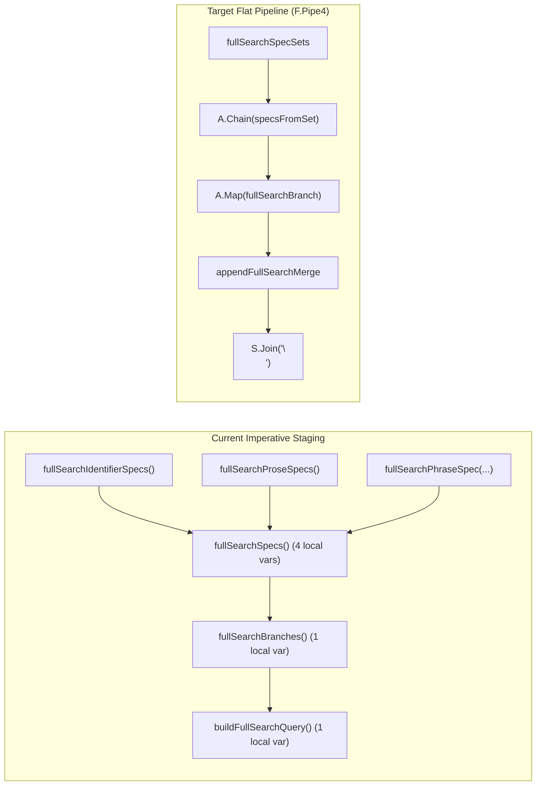

# Refactoring Plan: Declarative Flat Pipeline for `fullSearchSpecs` and `buildFullSearchQuery`

## Goal

Refactor `internal/repository/arangodb/fullsearch_query.go` in `modware-stock` to eliminate imperative intermediate variable bindings in `fullSearchIdentifierSpecPair`, `fullSearchSpecs`, `fullSearchBranches`, and `buildFullSearchQuery`.

Replace the ad-hoc slice assembly with a table-driven `fullSearchSpecSet` slice and a single flat `F.Pipe4` pipeline in `buildFullSearchQuery`, matching the declarative architecture used in `internal/repository/arangodb/autocomplete_query.go`.

---

## Current State vs. Target Architecture



### Problems in Current Code
1. **`fullSearchSpecs`** imperatively binds four local variables (`identifiers`, `prose`, `phraseSpec`, `phrase`) before calling `A.From` and `A.Flatten`.
2. **`fullSearchBranches`** binds a local `specs` variable just to pass it into `F.Pipe1(specs, A.Map(fullSearchBranch))`.
3. **`buildFullSearchQuery`** binds `branches := fullSearchBranches()` outside the pipe so it can pass `branches` both into `A.Map(bodyLens.Get)` and into `fullSearchMergeBlock(branches)`.
4. **`fullSearchIdentifierSpecPair`** binds `prefix` and `fuzzy` locally before `A.From(prefix, fuzzy)`.

---

## Detailed Design

### 1. Define `fullSearchSpecSet` Type
In `internal/repository/arangodb/fullsearch_query.go`, add `fullSearchSpecSet` alongside `branchSpec`:

```go
type (
	// branchSpec is everything one branch of the statement needs: the AQL
	// variable name, the indexed field, the SEARCH expression and the
	// score band. The build pipeline resolves the display expression and
	// the branch template from the field and writes both back here, so
	// the render step reads one value and nothing else.
	branchSpec struct {
		name     string
		field    fullSearchField
		search   string
		band     string
		display  string
		template string
	}

	// fullSearchSpecSet pairs a group of indexed fields with the indexed
	// builder that produces one or more branch specs per field.
	fullSearchSpecSet struct {
		fields  []fullSearchField
		builder func(int, fullSearchField) []branchSpec
	}
)
```

### 2. Define Package-Level `fullSearchSpecSets` Table
In the `var (...)` block of `internal/repository/arangodb/fullsearch_query.go`, declare `fullSearchSpecSets` in statement order:
- **Group 1**: `fullSearchIdentifierFields` (8 fields) -> `fullSearchIdentifierSpecPair` (produces `[p0, n0, ..., p7, n7]`, 16 branches)
- **Group 2**: `fullSearchProseFields` (2 fields) -> `fullSearchTokenSpecSlice` (produces `[t0, t1]`, 2 branches)
- **Group 3**: `A.Of(fullSearchProseFields[0])` (1 field: `summary`) -> `fullSearchPhraseSpecSlice` (produces `[h0]`, 1 branch)

```go
	// fullSearchSpecSets lists the three groups of branch specs in
	// statement order: identifier prefix+fuzzy pairs, prose token
	// branches, and the summary phrase branch.
	fullSearchSpecSets = []fullSearchSpecSet{
		{fullSearchIdentifierFields, fullSearchIdentifierSpecPair},
		{fullSearchProseFields, fullSearchTokenSpecSlice},
		{A.Of(fullSearchProseFields[0]), fullSearchPhraseSpecSlice},
	}
```

### 3. Unify Builder Signatures (`func(int, fullSearchField) []branchSpec`)
Update the spec builders in `internal/repository/arangodb/fullsearch_query.go` so each group builder conforms to `func(int, fullSearchField) []branchSpec` without imperative local variables:

```go
// fullSearchTokenSpecSlice is the single-element spec slice of the token
// branch of the prose field at position i: the variable t<i> with the
// prose band.
func fullSearchTokenSpecSlice(i int, f fullSearchField) []branchSpec {
	return A.Of(branchSpec{
		name:   fmt.Sprintf("t%d", i),
		field:  f,
		search: fullSearchTokenExpr(f.label),
		band:   fullSearchProseBand,
	})
}

// fullSearchPhraseSpecSlice is the single-element spec slice of the
// phrase branch at position i: the variable h<i> with the phrase band.
func fullSearchPhraseSpecSlice(i int, f fullSearchField) []branchSpec {
	return A.Of(branchSpec{
		name:   fmt.Sprintf("h%d", i),
		field:  f,
		search: fullSearchPhraseExpr(f.label),
		band:   fullSearchPhraseBand,
	})
}

// fullSearchIdentifierSpecPair makes the specs of both stages of one
// identifier field in statement order: the prefix branch, then the fuzzy
// branch.
func fullSearchIdentifierSpecPair(i int, f fullSearchField) []branchSpec {
	return A.From(
		fullSearchPrefixSpec(i, f),
		fullSearchFuzzySpec(i, f),
	)
}
```

### 4. Replace Intermediate Spec/Branch Functions with Flat Combinators
Remove `fullSearchIdentifierSpecs`, `fullSearchProseSpecs`, `fullSearchSpecs`, and `fullSearchBranches`, and replace them with `specsFromSet`, `appendFullSearchMerge`, and the flat `buildFullSearchQuery` pipeline:

```go
// specsFromSet expands one spec set into its branch specs in statement
// order.
func specsFromSet(set fullSearchSpecSet) []branchSpec {
	return F.Pipe2(
		set.fields,
		A.MapWithIndex(set.builder),
		A.Flatten[branchSpec],
	)
}

// appendFullSearchMerge extracts the rendered LET bodies of the branches
// and appends the trailing merge block.
func appendFullSearchMerge(branches []queryBranch) []string {
	return F.Pipe2(
		branches,
		A.Map(bodyLens.Get),
		F.Bind2nd(A.Append, fullSearchMergeBlock(branches)),
	)
}

// buildFullSearchQuery generates the full statement: the LET blocks of
// the branches and the merge block.
func buildFullSearchQuery() string {
	return F.Pipe4(
		fullSearchSpecSets,
		A.Chain(specsFromSet),
		A.Map(fullSearchBranch),
		appendFullSearchMerge,
		S.Join("\n"),
	)
}
```

---

## Proposed Diff (`internal/repository/arangodb/fullsearch_query.go`)

```diff
--- a/internal/repository/arangodb/fullsearch_query.go
+++ b/internal/repository/arangodb/fullsearch_query.go
@@ -25,6 +25,13 @@ type (
 		display  string
 		template string
 	}
+
+	// fullSearchSpecSet pairs a group of indexed fields with the indexed
+	// builder that produces one or more branch specs per field.
+	fullSearchSpecSet struct {
+		fields  []fullSearchField
+		builder func(int, fullSearchField) []branchSpec
+	}
 )
 
 var (
@@ -60,6 +67,15 @@ var (
 		isPropCollection,
 		P.Fold(stockBranchTemplate, propBranchTemplate),
 	)
+
+	// fullSearchSpecSets lists the three groups of branch specs in
+	// statement order: identifier prefix+fuzzy pairs, prose token
+	// branches, and the summary phrase branch.
+	fullSearchSpecSets = []fullSearchSpecSet{
+		{fullSearchIdentifierFields, fullSearchIdentifierSpecPair},
+		{fullSearchProseFields, fullSearchTokenSpecSlice},
+		{A.Of(fullSearchProseFields[0]), fullSearchPhraseSpecSlice},
+	}
 )
 
 // isFullSearchScalar reports whether the field displays as a scalar.
@@ -171,74 +187,44 @@ func fullSearchFuzzySpec(i int, f fullSearchField) branchSpec {
 	}
 }
 
-// fullSearchTokenSpec is the spec of the token branch of the prose field
-// at position i: the variable t<i> with the prose band.
-func fullSearchTokenSpec(i int, f fullSearchField) branchSpec {
-	return branchSpec{
+// fullSearchTokenSpecSlice is the single-element spec slice of the token
+// branch of the prose field at position i: the variable t<i> with the
+// prose band.
+func fullSearchTokenSpecSlice(i int, f fullSearchField) []branchSpec {
+	return A.Of(branchSpec{
 		name:   fmt.Sprintf("t%d", i),
 		field:  f,
 		search: fullSearchTokenExpr(f.label),
 		band:   fullSearchProseBand,
-	}
+	})
 }
 
-// fullSearchPhraseSpec is the spec of the single phrase branch over
-// summary: the variable h0 with the phrase band.
-func fullSearchPhraseSpec(f fullSearchField) branchSpec {
-	return branchSpec{
-		name:   "h0",
+// fullSearchPhraseSpecSlice is the single-element spec slice of the
+// phrase branch at position i: the variable h<i> with the phrase band.
+func fullSearchPhraseSpecSlice(i int, f fullSearchField) []branchSpec {
+	return A.Of(branchSpec{
+		name:   fmt.Sprintf("h%d", i),
 		field:  f,
 		search: fullSearchPhraseExpr(f.label),
 		band:   fullSearchPhraseBand,
-	}
+	})
 }
 
 // fullSearchIdentifierSpecPair makes the specs of both stages of one
 // identifier field in statement order: the prefix branch, then the fuzzy
 // branch.
 func fullSearchIdentifierSpecPair(i int, f fullSearchField) []branchSpec {
-	prefix := fullSearchPrefixSpec(i, f)
-	fuzzy := fullSearchFuzzySpec(i, f)
-	return A.From(prefix, fuzzy)
+	return A.From(
+		fullSearchPrefixSpec(i, f),
+		fullSearchFuzzySpec(i, f),
+	)
 }
 
-// fullSearchIdentifierSpecs makes the prefix spec and the fuzzy spec of
-// every identifier field.
-func fullSearchIdentifierSpecs() []branchSpec {
+// specsFromSet expands one spec set into its branch specs in statement
+// order.
+func specsFromSet(set fullSearchSpecSet) []branchSpec {
 	return F.Pipe2(
-		fullSearchIdentifierFields,
-		A.MapWithIndex(fullSearchIdentifierSpecPair),
+		set.fields,
+		A.MapWithIndex(set.builder),
 		A.Flatten[branchSpec],
 	)
 }
 
-// fullSearchProseSpecs makes the token spec of every prose field.
-func fullSearchProseSpecs() []branchSpec {
-	return F.Pipe1(
-		fullSearchProseFields,
-		A.MapWithIndex(fullSearchTokenSpec),
-	)
-}
-
-// fullSearchSpecs makes the specs of all 19 branches in statement order:
-// both stages of every identifier field, then the token branch of every
-// prose field, then the single phrase branch.
-func fullSearchSpecs() []branchSpec {
-	identifiers := fullSearchIdentifierSpecs()
-	prose := fullSearchProseSpecs()
-	phraseSpec := fullSearchPhraseSpec(fullSearchProseFields[0])
-	phrase := A.Of(phraseSpec)
-	return F.Pipe1(
-		A.From(identifiers, prose, phrase),
-		A.Flatten[branchSpec],
-	)
-}
-
-// fullSearchBranches renders every spec of the statement.
-func fullSearchBranches() []queryBranch {
-	specs := fullSearchSpecs()
-	return F.Pipe1(specs, A.Map(fullSearchBranch))
-}
-
 // fullSearchMergeBlock makes the merge of the statement. It keeps one
 // best row per stock key, reads the stock document after the tail limit
 // and returns the top rows.
@@ -252,15 +238,24 @@ func fullSearchMergeBlock(branches []queryBranch) string {
 	)
 }
 
-// buildFullSearchQuery generates the full statement: the LET blocks of
-// the branches and the merge block.
-func buildFullSearchQuery() string {
-	branches := fullSearchBranches()
-
-	return F.Pipe3(
+// appendFullSearchMerge extracts the rendered LET bodies of the branches
+// and appends the trailing merge block.
+func appendFullSearchMerge(branches []queryBranch) []string {
+	return F.Pipe2(
 		branches,
 		A.Map(bodyLens.Get),
 		F.Bind2nd(A.Append, fullSearchMergeBlock(branches)),
+	)
+}
+
+// buildFullSearchQuery generates the full statement: the LET blocks of
+// the branches and the merge block.
+func buildFullSearchQuery() string {
+	return F.Pipe4(
+		fullSearchSpecSets,
+		A.Chain(specsFromSet),
+		A.Map(fullSearchBranch),
+		appendFullSearchMerge,
 		S.Join("\n"),
 	)
 }
```

---

## Impact & Verification Checklist

No external callers or test files reference `fullSearchIdentifierSpecs`, `fullSearchProseSpecs`, `fullSearchPhraseSpec`, `fullSearchTokenSpec`, `fullSearchSpecs`, or `fullSearchBranches`. All builder unit tests in `internal/repository/arangodb/fullsearch_test.go` test `buildFullSearchQuery`, and the generated AQL string remains byte-for-byte identical.

When implementing this plan, run the standard verification steps in `/Users/sba964/Projects/devenv/golang/modware-stock`:

1. **Unit Tests (Builder tests — no DB required):**
   ```bash
   gotestsum --format-hide-empty-pkg --format dots -- -run "TestBuildFullSearchQuery" ./internal/repository/arangodb/...
   ```
2. **All Tests:**
   ```bash
   gotestsum --format-hide-empty-pkg --format dots
   ```
3. **Linting:**
   ```bash
   golangci-lint run
   ```
4. **Formatting:**
   ```bash
   golangci-lint fmt
   ```
