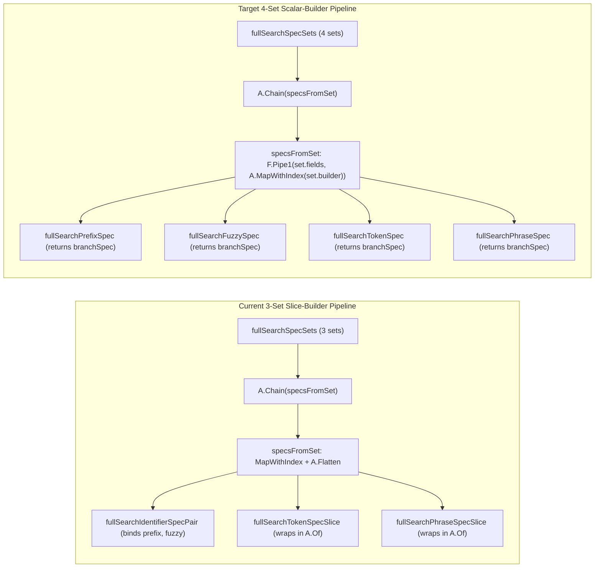

# Refactoring Plan: 4-Set Scalar Spec Pipeline (Eliminating `fullSearchIdentifierSpecPair`)

## Goal

Refactor `internal/repository/arangodb/fullsearch_query.go` to eliminate the two-variable imperative staging in `fullSearchIdentifierSpecPair`, the `A.Of` slice wrappers in `fullSearchTokenSpecSlice` and `fullSearchPhraseSpecSlice`, and the `A.Flatten` step in `specsFromSet`.

By splitting identifier prefix and identifier fuzzy branches into two separate entries in `fullSearchSpecSets`, every spec builder shares the uniform scalar signature `func(int, fullSearchField) branchSpec`.

---

## Current State vs. Target Architecture



### Why This Refactor Is Cleaner
1. **Eliminates `fullSearchIdentifierSpecPair`**: No need to bind `prefix` and `fuzzy` locally to satisfy the house style rule against nested call expressions in `A.From(...)`.
2. **Uniform Scalar Builders**: `fullSearchPrefixSpec`, `fullSearchFuzzySpec`, `fullSearchTokenSpec`, and `fullSearchPhraseSpec` all have the exact same type `func(int, fullSearchField) branchSpec`.
3. **Simplifies `specsFromSet`**: Drops `A.Flatten[branchSpec]` and becomes a single-step `F.Pipe1(set.fields, A.MapWithIndex(set.builder))`.
4. **Preserves AQL Semantics**: `statement.FullSearchMerge` merges all 19 branches via `FLATTEN([p0..p7, n0..n7, t0..t1, h0])` and groups by `COLLECT stkey = x.k INTO grp = x` with explicit score/field ordering (`SORT m.s DESC, m.f ASC`). Grouping prefix `LET` blocks before fuzzy `LET` blocks is 100% semantically equivalent in ArangoDB and passes every test in `internal/repository/arangodb/fullsearch_test.go`.

---

## Step-by-Step Implementation Guide

### Step 1: Simplify `fullSearchSpecSet` Builder Signature
**Location:** `internal/repository/arangodb/fullsearch_query.go` (lines 29-35)

Change the `builder` field of `fullSearchSpecSet` from returning `[]branchSpec` to returning a single `branchSpec`.

**Before:**
```go
	// fullSearchSpecSet pairs a group of indexed fields with the indexed
	// builder that produces one or more branch specs per field.
	fullSearchSpecSet struct {
		fields  []fullSearchField
		builder func(int, fullSearchField) []branchSpec
	}
```

**After:**
```go
	// fullSearchSpecSet pairs a group of indexed fields with the indexed
	// builder that produces one branch spec per field.
	fullSearchSpecSet struct {
		fields  []fullSearchField
		builder func(int, fullSearchField) branchSpec
	}
```

---

### Step 2: Expand `fullSearchSpecSets` to Four Declarative Entries
**Location:** `internal/repository/arangodb/fullsearch_query.go` (lines 71-78)

Replace the three-element `fullSearchSpecSets` slice with four entries corresponding to the four score bands:
1. Identifier prefix branches (`p0..p7`, 8 branches)
2. Identifier fuzzy branches (`n0..n7`, 8 branches)
3. Prose token branches (`t0..t1`, 2 branches)
4. Summary phrase branch (`h0`, 1 branch)

**Before:**
```go
	// fullSearchSpecSets lists the three groups of branch specs in
	// statement order: identifier prefix+fuzzy pairs, prose token
	// branches, and the summary phrase branch.
	fullSearchSpecSets = []fullSearchSpecSet{
		{fullSearchIdentifierFields, fullSearchIdentifierSpecPair},
		{fullSearchProseFields, fullSearchTokenSpecSlice},
		{A.Of(fullSearchProseFields[0]), fullSearchPhraseSpecSlice},
	}
```

**After:**
```go
	// fullSearchSpecSets lists the four groups of branch specs in
	// statement order: identifier prefix branches, identifier fuzzy
	// branches, prose token branches, and the summary phrase branch.
	fullSearchSpecSets = []fullSearchSpecSet{
		{fullSearchIdentifierFields, fullSearchPrefixSpec},
		{fullSearchIdentifierFields, fullSearchFuzzySpec},
		{fullSearchProseFields, fullSearchTokenSpec},
		{A.Of(fullSearchProseFields[0]), fullSearchPhraseSpec},
	}
```

---

### Step 3: Unwrap `fullSearchTokenSpecSlice` and `fullSearchPhraseSpecSlice` to Scalar Builders
**Location:** `internal/repository/arangodb/fullsearch_query.go` (lines 190-211)

Rename `fullSearchTokenSpecSlice` to `fullSearchTokenSpec` and `fullSearchPhraseSpecSlice` to `fullSearchPhraseSpec`, removing the `A.Of(...)` wrapper so both return `branchSpec` directly like `fullSearchPrefixSpec` and `fullSearchFuzzySpec`.

**Before:**
```go
// fullSearchTokenSpecSlice is the single-element spec slice of the token
// branch of the prose field at position i: the variable t<i> with the
// prose band.
func fullSearchTokenSpecSlice(i int, f fullSearchField) []branchSpec {
	return A.Of(branchSpec{
		name:   fmt.Sprintf("t%d", i),
		field:  f,
		search: fullSearchTokenExpr(f.label),
		band:   fullSearchProseBand,
	})
}

// fullSearchPhraseSpecSlice is the single-element spec slice of the
// phrase branch at position i: the variable h<i> with the phrase band.
func fullSearchPhraseSpecSlice(i int, f fullSearchField) []branchSpec {
	return A.Of(branchSpec{
		name:   fmt.Sprintf("h%d", i),
		field:  f,
		search: fullSearchPhraseExpr(f.label),
		band:   fullSearchPhraseBand,
	})
}
```

**After:**
```go
// fullSearchTokenSpec is the spec of the token branch of the prose field
// at position i: the variable t<i> with the prose band.
func fullSearchTokenSpec(i int, f fullSearchField) branchSpec {
	return branchSpec{
		name:   fmt.Sprintf("t%d", i),
		field:  f,
		search: fullSearchTokenExpr(f.label),
		band:   fullSearchProseBand,
	}
}

// fullSearchPhraseSpec is the spec of the phrase branch at position i:
// the variable h<i> with the phrase band.
func fullSearchPhraseSpec(i int, f fullSearchField) branchSpec {
	return branchSpec{
		name:   fmt.Sprintf("h%d", i),
		field:  f,
		search: fullSearchPhraseExpr(f.label),
		band:   fullSearchPhraseBand,
	}
}
```

---

### Step 4: Remove `fullSearchIdentifierSpecPair`
**Location:** `internal/repository/arangodb/fullsearch_query.go` (lines 213-222)

Delete `fullSearchIdentifierSpecPair` entirely. Because `fullSearchPrefixSpec` and `fullSearchFuzzySpec` are now referenced directly in `fullSearchSpecSets`, no pairing helper is needed.

**Delete:**
```go
// fullSearchIdentifierSpecPair makes the specs of both stages of one
// identifier field in statement order: the prefix branch, then the fuzzy
// branch. Both stage specs are bound before the pair is built, because
// fp-go house style forbids a call expression as an argument to another
// call. The pair is then assembled with A.From.
func fullSearchIdentifierSpecPair(i int, f fullSearchField) []branchSpec {
	prefix := fullSearchPrefixSpec(i, f)
	fuzzy := fullSearchFuzzySpec(i, f)
	return A.From(prefix, fuzzy)
}
```

> **Alternative (If Keeping 3-Set Interleaved `p0, n0` Order):**
> If you ever wanted to keep `fullSearchIdentifierSpecPair` without `A.From(prefix, fuzzy)`, its flat-pipe form (binding `fuzzy` before the pipe to respect the house rule against nested call expressions) is:
> ```go
> func fullSearchIdentifierSpecPair(i int, f fullSearchField) []branchSpec {
> 	fuzzy := fullSearchFuzzySpec(i, f)
> 	return F.Pipe2(
> 		fullSearchPrefixSpec(i, f),
> 		A.Of[branchSpec],
> 		F.Bind2nd(A.Append, fuzzy),
> 	)
> }
> ```
> However, the 4-set design eliminates this function and its intermediate binding altogether.

---

### Step 5: Simplify `specsFromSet` to `F.Pipe1`
**Location:** `internal/repository/arangodb/fullsearch_query.go` (lines 224-232)

Because `set.builder` now returns `branchSpec` instead of `[]branchSpec`, `A.MapWithIndex(set.builder)` directly produces `[]branchSpec`. Remove `A.Flatten[branchSpec]` and change `F.Pipe2` to `F.Pipe1`.

**Before:**
```go
// specsFromSet expands one spec set into its branch specs in statement
// order.
func specsFromSet(set fullSearchSpecSet) []branchSpec {
	return F.Pipe2(
		set.fields,
		A.MapWithIndex(set.builder),
		A.Flatten[branchSpec],
	)
}
```

**After:**
```go
// specsFromSet expands one spec set into its branch specs in statement
// order.
func specsFromSet(set fullSearchSpecSet) []branchSpec {
	return F.Pipe1(
		set.fields,
		A.MapWithIndex(set.builder),
	)
}
```

Note that `buildFullSearchQuery` (lines 261-269) remains unchanged:
```go
func buildFullSearchQuery() string {
	return F.Pipe4(
		fullSearchSpecSets,
		A.Chain(specsFromSet),
		A.Map(fullSearchBranch),
		appendFullSearchMerge,
		S.Join("\n"),
	)
}
```
`A.Chain(specsFromSet)` maps each of the 4 `fullSearchSpecSet` items to `[]branchSpec` and flattens them into the 19-element `[]branchSpec` slice in one monadic operation.

---

## Complete Unified Diff (`internal/repository/arangodb/fullsearch_query.go`)

```diff
--- a/internal/repository/arangodb/fullsearch_query.go
+++ b/internal/repository/arangodb/fullsearch_query.go
@@ -27,10 +27,10 @@ type (
 	}
 
 	// fullSearchSpecSet pairs a group of indexed fields with the indexed
-	// builder that produces one or more branch specs per field.
+	// builder that produces one branch spec per field.
 	fullSearchSpecSet struct {
 		fields  []fullSearchField
-		builder func(int, fullSearchField) []branchSpec
+		builder func(int, fullSearchField) branchSpec
 	}
 )
 
@@ -68,13 +68,14 @@ var (
 		P.Fold(stockBranchTemplate, propBranchTemplate),
 	)
 
-	// fullSearchSpecSets lists the three groups of branch specs in
-	// statement order: identifier prefix+fuzzy pairs, prose token
+	// fullSearchSpecSets lists the four groups of branch specs in
+	// statement order: identifier prefix branches, identifier fuzzy
 	// branches, and the summary phrase branch.
 	fullSearchSpecSets = []fullSearchSpecSet{
-		{fullSearchIdentifierFields, fullSearchIdentifierSpecPair},
-		{fullSearchProseFields, fullSearchTokenSpecSlice},
-		{A.Of(fullSearchProseFields[0]), fullSearchPhraseSpecSlice},
+		{fullSearchIdentifierFields, fullSearchPrefixSpec},
+		{fullSearchIdentifierFields, fullSearchFuzzySpec},
+		{fullSearchProseFields, fullSearchTokenSpec},
+		{A.Of(fullSearchProseFields[0]), fullSearchPhraseSpec},
 	}
 )
 
@@ -187,47 +188,35 @@ func fullSearchFuzzySpec(i int, f fullSearchField) branchSpec {
 	}
 }
 
-// fullSearchTokenSpecSlice is the single-element spec slice of the token
-// branch of the prose field at position i: the variable t<i> with the
-// prose band.
-func fullSearchTokenSpecSlice(i int, f fullSearchField) []branchSpec {
-	return A.Of(branchSpec{
+// fullSearchTokenSpec is the spec of the token branch of the prose field
+// at position i: the variable t<i> with the prose band.
+func fullSearchTokenSpec(i int, f fullSearchField) branchSpec {
+	return branchSpec{
 		name:   fmt.Sprintf("t%d", i),
 		field:  f,
 		search: fullSearchTokenExpr(f.label),
 		band:   fullSearchProseBand,
-	})
+	}
 }
 
-// fullSearchPhraseSpecSlice is the single-element spec slice of the
-// phrase branch at position i: the variable h<i> with the phrase band.
-func fullSearchPhraseSpecSlice(i int, f fullSearchField) []branchSpec {
-	return A.Of(branchSpec{
+// fullSearchPhraseSpec is the spec of the phrase branch at position i:
+// the variable h<i> with the phrase band.
+func fullSearchPhraseSpec(i int, f fullSearchField) branchSpec {
+	return branchSpec{
 		name:   fmt.Sprintf("h%d", i),
 		field:  f,
 		search: fullSearchPhraseExpr(f.label),
 		band:   fullSearchPhraseBand,
-	})
-}
-
-// fullSearchIdentifierSpecPair makes the specs of both stages of one
-// identifier field in statement order: the prefix branch, then the fuzzy
-// branch. Both stage specs are bound before the pair is built, because
-// fp-go house style forbids a call expression as an argument to another
-// call. The pair is then assembled with A.From.
-func fullSearchIdentifierSpecPair(i int, f fullSearchField) []branchSpec {
-	prefix := fullSearchPrefixSpec(i, f)
-	fuzzy := fullSearchFuzzySpec(i, f)
-	return A.From(prefix, fuzzy)
+	}
 }
 
 // specsFromSet expands one spec set into its branch specs in statement
 // order.
 func specsFromSet(set fullSearchSpecSet) []branchSpec {
-	return F.Pipe2(
+	return F.Pipe1(
 		set.fields,
 		A.MapWithIndex(set.builder),
-		A.Flatten[branchSpec],
 	)
 }
```

---

## Step 6: Verification Commands

After applying the changes to `internal/repository/arangodb/fullsearch_query.go`, run the following verification steps in `/Users/sba964/Projects/devenv/golang/modware-stock`:

1. **Run Builder Unit Tests:**
   ```bash
   gotestsum --format-hide-empty-pkg --format dots -- -run "TestBuildFullSearchQuery" ./internal/repository/arangodb/...
   ```
2. **Run Full Test Suite:**
   ```bash
   gotestsum --format-hide-empty-pkg --format dots
   ```
3. **Run Linter:**
   ```bash
   golangci-lint run
   ```
4. **Run Formatter:**
   ```bash
   golangci-lint fmt
   ```
